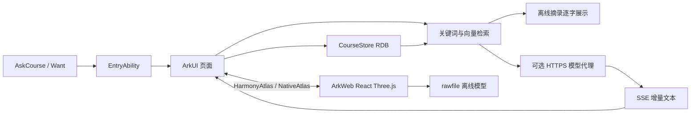

# 设计与移植说明

## 工程边界

知体是独立 Stage 应用；原课程应用和听见保持各自包名、构建配置及数据。四个页签分别为解剖、问答、资料、学习。设置、资料编辑、引用原文和结构详情在原生界面展示。

## 数据和一致性

| 表 | 主要字段 | 用途 |
| --- | --- | --- |
| documents | id、title、source、body、revision、updated | 课程资料全文 |
| segments | document_id、text、start、end、revision、vector、model | 精确引用位置和检索索引 |
| structures | id、name、system、concept_id、time、note、favorite | 浏览、收藏和笔记 |
| meta | key、value | 首次初始化标记、云端设置 |

写入队列串行执行事务。资料修改时读取数据库当前版本并递增，删除旧片段后重新切分；失败回滚。删除资料同时删除其片段。异步向量写入仅更新匹配片段 ID 和版本的记录，迟到的网络请求不能恢复已删除内容。

片段窗口约 440 个 UTF-16 单元，重叠约 60 单元，优先句末切分并保护代理对。引用保存正文偏移和版本；来源页突出显示精确原文片段。资料提交成功后取消当前回答并清空会话，下一次查询使用新索引；历史引用入口另有版本失效检查。

## 检索与回答

本地提取英文术语、中文双字词及少量课程同义词；正文命中使用 IDF 权重，标题加权。配置云端后先获取问题向量，再批量补齐未缓存片段；缓存模型键包含服务地址、模型和维度。只比较同模型向量，以余弦相似度筛选语义候选。两路排名按 `1/(60+rank)` 融合，最多返回 4 段。

离线回答从命中片段抽取含查询词的句子，附 `[n]` 引用，按 Unicode 码点逐字展示。云端回答使用资料约束提示词和 SSE 增量文本。每次提问分配代次标识，停止、修改资料或新请求会使旧响应失效。每个气泡使用 `@Observed ChatMessage` 与 `@ObjectLink ChatCard`，保证逐字变化触发界面刷新。

## Web 移植改动

- 保留上游 React、Three.js、模型目录及验证脚本，固定上游提交，见 `web/UPSTREAM.json`。
- 增加常用结构中文别名和精确概念搜索；选择结果、ready、进度及错误传入原生层。
- 原生通过 `runJavaScript` 调用搜索、定位、独立显示，参数以 JSON 序列化；返回结果兼容 ArkWeb 字符串的再次 JSON 编码并校验数组类型。
- 使用 `https://atlas.local` 虚拟源映射 rawfile；拒绝外部资源、目录穿越及外部页面导航。
- 防止隐藏页面的零尺寸影响相机计算；选择被系统显隐操作清空时同步清理详情；输入编辑区域不触发 `/` 快捷键。
- API 24 模拟器实测：模型与 GPU 绘制均已完成，但状态缓存导致画面空白；在原生桥接环境的绘制前调用 `renderer.resetState()` 后恢复。此处理不改变模型数据，也不替换为截图。

## 错误处理

初始化、资料处理、检索、向量化、回答分别显示状态。保存失败保留编辑内容；删除需确认。无命中建议更换关键词或添加资料。云端无网、地址未配置、HTTP 错误、超时、截断和非法 SSE 均展示失败并允许重试。模型加载失败显示重试；离线资料与模型无需外网。
