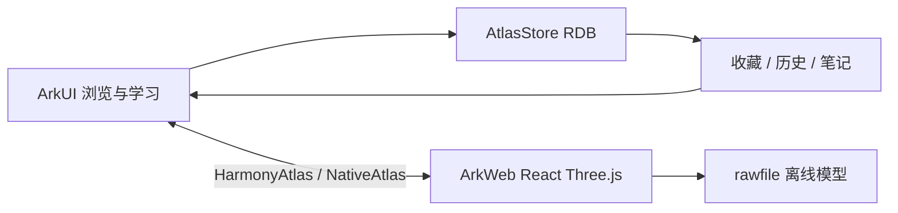

# 实验二设计与移植说明

## 工程边界

知体是独立 Stage 应用。原课程学习应用、实验一“听见”保持各自包名、构建配置和数据。知体包含“浏览”“学习”两个页签，默认进入人体模型；结构详情、笔记和关于页面使用原生 ArkUI。

课程知识问答、课程资料管理、云端模型服务及 ArkAF 问答入口属于仓库根目录的课程项目，不包含在实验二中。

## 本地学习记录

`model/Structure.ets` 定义结构记录，`model/AtlasStore.ets` 提供 `init`、`visit`、`updateStructure`、`structures`。写入队列串行执行，访问记录使用事务写入。再次浏览只刷新时间，不覆盖已保存的收藏和笔记。查询保留最近 300 条浏览记录，并额外保留更早的收藏结构。

| 数据项 | 主要字段 |
|---|---|
| 结构身份与名称 | id、name、system、concept_id、description |
| 学习记录 | time、note、favorite |

数据库继续使用 `anatomy_course.db` 和原来的 `structures` 表结构。更新安装时不更改数据库名、不清空数据。以前版本存在的讲义表保持原样，但不再读写，也不再导入种子课程资料；新安装只创建学习记录表。

## Web 移植

- 保留上游 React、Three.js、模型目录及验证脚本，固定上游提交，见 `web/UPSTREAM.json`。
- 增加常用结构中文别名和精确概念搜索；选择结果、ready、进度及错误传入原生层。
- 原生通过 `runJavaScript` 调用搜索、定位、独立显示，参数以 JSON 序列化；返回结果兼容 ArkWeb 字符串的再次 JSON 编码并校验数组类型。
- 使用 `https://atlas.local` 虚拟源映射 rawfile；拒绝外部资源、目录穿越和外部页面导航，所有资源读取被原生映射到本地。移除 INTERNET 与 GET_NETWORK_INFO 权限。
- 防止隐藏页面的零尺寸影响相机计算；输入编辑区域不触发 `/` 快捷键。
- API 24 模拟器曾出现模型加载完成但画面空白，在原生桥接环境绘制前调用 `renderer.resetState()` 后恢复。保留此兼容处理，不更改模型数据。

## 状态与恢复

初次打开显示学习记录初始化状态；失败可重新初始化。模型显示加载百分比，Web 错误或超过 60 秒未加载完成时展示重试按钮。搜索无结果时建议尝试中英文名称或模型编号；保存失败保留编辑文字，用户可再次保存。模型与学习记录均离线可用。
