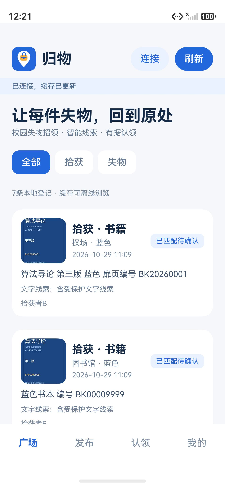
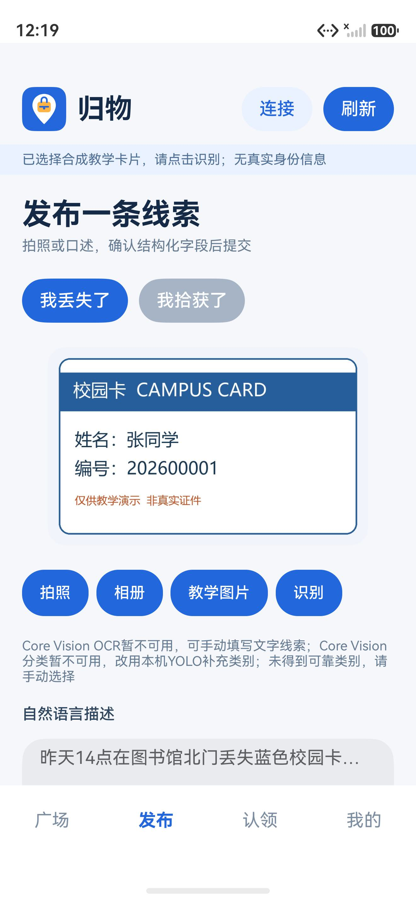
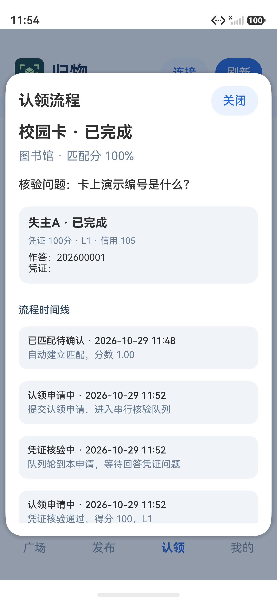
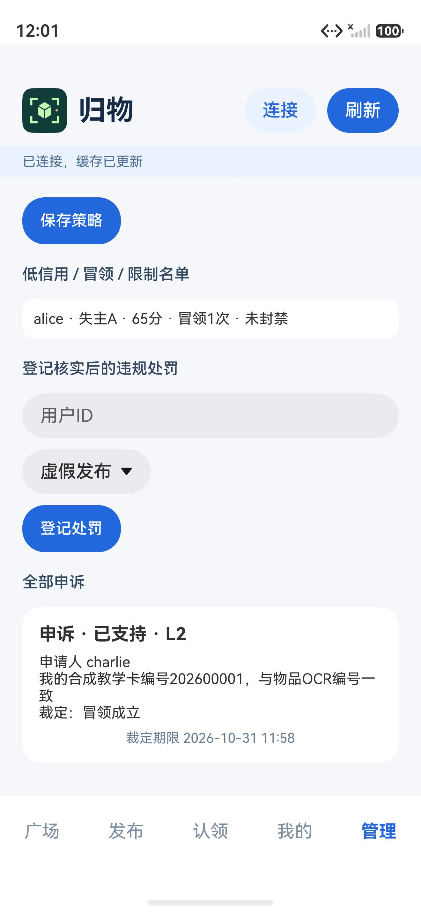
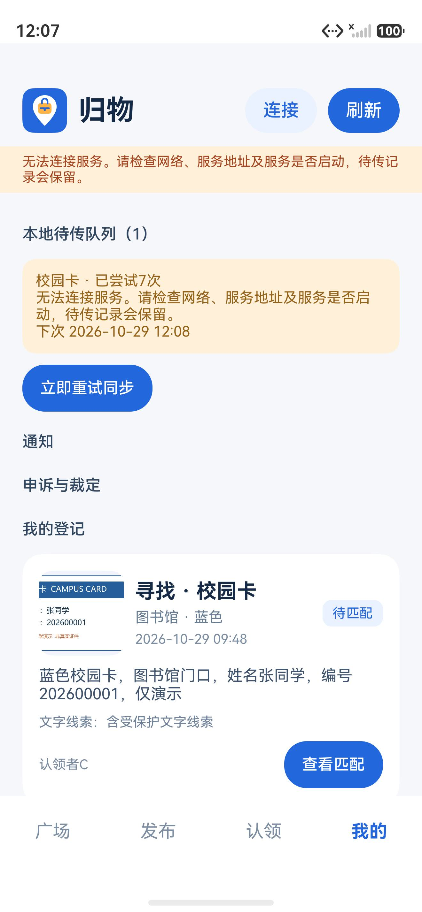
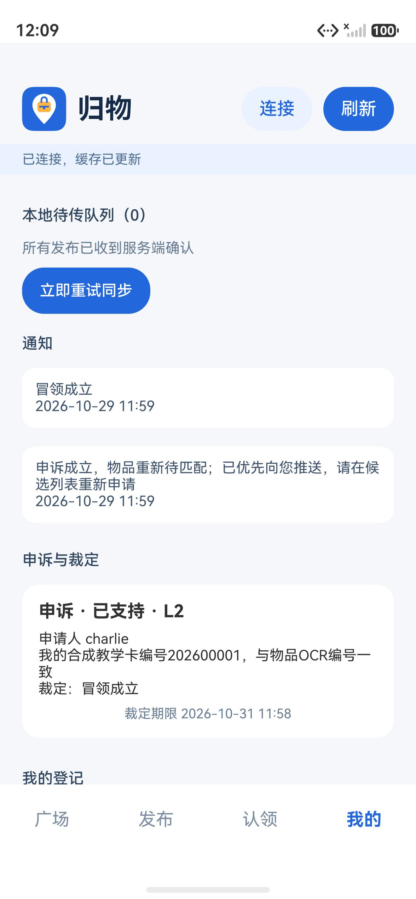
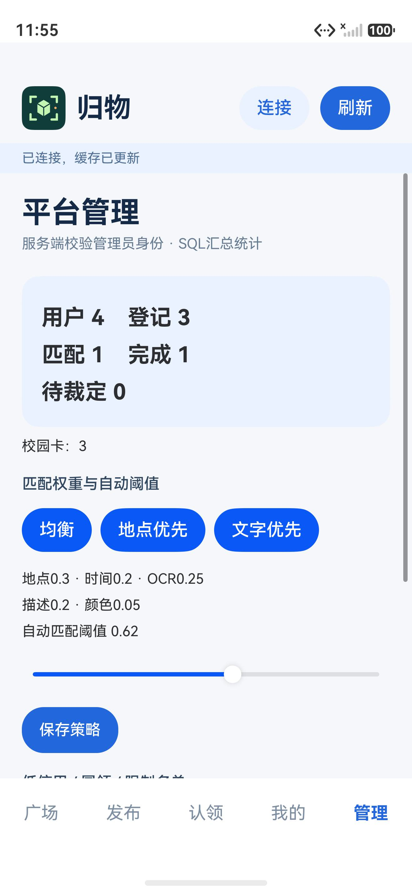

# 实验四验收记录

日期2026-10-29。Windows，DevEco Studio配套HarmonyOS6.1.1/API24，Pura90模拟器；本机FastAPI通过HDC转发8766端口。使用四个随机口令教学账号及合成卡片、图书资料。

## 已完成验证

| 检查 | 结果和实际范围 |
|---|---|
| DevEco构建 | `assembleHap`通过，包含arm64-v8a与x86_64原生库；未签名HAP实际安装并启动 |
| 后端测试 | **15项通过**；测试实际FastAPI/SQLite事务，覆盖JWT过期/伪造、角色403、并发幂等、评分、低分人工申请、状态前置、串行队列、竞领排序、证据等级与高等级人工审核、申诉两种裁定及超时、信用门槛和禁止认领、游标分页、同一失物不可重复完成、SQL统计与安全错误 |
| 客户端测试 | 加载真实ETS规则、CacheStore和CampusSync，使用真实SQLite：日期和规则抽取、持久化队列恢复、账号隔离、退避、并发串行写、事务失败回滚、ACK错ID和游标回退均通过。网络为模拟替身，设备RDB另由重启验证 |
| 图片采集 | CameraKit实际授权、后置预览、拍照并回传；PhotoViewPicker实际选择既有上游公交样图，返回URI并复制到归物私有文件显示。采集验证照片未发布到服务器或仓库 |
| 系统视觉 | 合成教学卡调用真实OCR与CoreVision通用分类；本模拟器均提示不可用。YOLO真实推理完成但未给出可靠校园类别，页面保留手选，没有伪造识别结果 |
| 语音和文本 | 实际麦克风授权后CoreSpeech返回401，显示可重试提示；NaturalLanguageKit实际调用不可用，明确标注校园规则回填。输入“昨天14点在图书馆北门丢失蓝色校园卡”后类别、颜色、地点与时间正确回填并可修改 |
| 领取主链 | alice查看候选并申请→L1作答通过→bob确认完成；时间线可见，alice信用100→105 |
| 申诉主链 | charlie针对已完成记录提交同编号L2文字→锁定申诉中→admin裁定成立→原流程关闭、物品重开、通知申诉人，alice信用105→65且冒领次数1 |
| 管理员UI | admin显示管理页、SQL统计、申诉及违规名单；普通用户无管理页。服务端直接越权测试403 |
| 离线与重传 | 移除HDC的8766转发后发布；失败队列显示次数与下次时间；强停重启仍保留同一任务；恢复转发后等待退避和前台定时器，无手动同步即上传，队列1→0。服务端确认新登记只有1条 |

超时、多人同时申请及竞领多位通过的分支用自动接口测试和可控时钟验证，未通过修改模拟器系统时间演示。断线测试模拟的是后端不可达，不等同于物理Wi-Fi切换。后台不常驻上传，回到前台继续；超时采用请求时懒检查。

## 权重改变排序的实际服务对照

alice的 `demo-book-lost` 与两条同类别、相隔1小时的图书招领比较，登记内容保持不变：

| 策略 | 同地点异编号 demo-book-near | 异地点同编号 demo-book-text | 第一候选 |
|---|---:|---:|---|
| 地点优先 0.60/0.15/0.10/0.10/0.05 | 0.8213 | 0.3991 | near，达到0.62自动阈值 |
| 文字优先 0.10/0.10/0.45/0.30/0.05 | 0.3161 | 0.8994 | text，达到0.62自动阈值 |

数值依次为地点、时间、OCR、描述、颜色权重。管理员页面实际保存过策略；候选通过HTTP请求重算，第一候选和是否自动匹配互换。已有匹配冻结创建时评分，不随策略追溯修改。

## 复验命令

在本独立App目录：

```powershell
./scripts/run-server.ps1
# 另开终端
./.venv/Scripts/python.exe -m pytest server/tests -q
node scripts/test-client.cjs --deveco-home 'D:/HUAWEI/DevEco Studio'
./scripts/build.ps1
& 'D:/HUAWEI/DevEco Studio/sdk/default/openharmony/toolchains/hdc.exe' rport tcp:8766 tcp:8766
```

手动安装HAP可使用Windows绝对反斜杠路径。多设备时添加 `-t <target>`。App登录用本机`.local/accounts.json`中的随机口令；勿将口令放进截图。断线使用 `hdc fport rm tcp:8766 tcp:8766`，两个端口是独立参数；恢复用 `hdc rport tcp:8766 tcp:8766`，保持应用前台并等待当前退避期限（最多5分钟）结束。

## 界面证据

截图来自本次实际开发和联调，早期流程截图使用开发阶段图标，最终图标为蓝色定位与物品图形。只包含合成教学数据。









## 验证边界

尚未验证物理手机上的OCR、语音、系统分类与NLP效果、长期并发负载、功耗和后台运行；后端没有部署公共HTTPS地址。L3要求图片和匹配编号，但不自动确认材料真伪，须发布者或管理员对照审核。YOLO仅覆盖COCO80子集，不能可靠识别所有校园物品。上述限制均在页面或设计文档明确说明。
