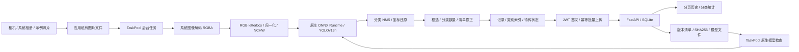

# 实验三设计与接口

## 数据流

## 推理与显示

输入固定为`float32 [1,3,640,640]`。保持宽高比，缩放后的整数尺寸记录精确`scaleX/scaleY`、左右/上下padding；填充像素为114，RGB除以255后存入连续CHW平面。双线性采样在前处理实现，可用小图片进行逐值测试。

官方COCO检测头输出`[1,84,8400]`，也接受转置布局`[1,8400,84]`。前4通道是中心坐标及宽高，后80通道是类别置信度，不额外乘一个不存在的objectness通道。取最大类别概率后按阈值过滤，同类别IoU>0.45进行NMS，最多保留100框；不同类别不相互抑制。

框坐标减padding后除以实际缩放比例，再裁剪到原图边界。原图使用`ImageFit.Contain`，Canvas绘制时再次计算显示缩放与居中偏移。像素空间与界面空间分别转换，避免长图和宽图框位移。

`InferenceService`在任何解码开始前设置互斥状态，后续提交直接给出等待提示。默认任务用`@Concurrent`和`taskpool.execute`执行，UI只接收小型检测结果与耗时。原生N-API调用ONNX Runtime同步API，但调用线程是TaskPool线程；C++内部再用互斥锁保护会话缓存。

性能面板记录解码、letterbox、模型加载、Session.Run、后处理和总耗时。每50ms主线程心跳测量超出预期间隔的最大延迟，完成后等一次定时器调度再读数；它是界面响应观察指标，不是显示器帧率，也不等于模型执行时间。对照使用同一图片和阈值顺序执行TaskPool及主线程模式，同步模式仅用于实验比较。

## 本地存储与修订

| 表 | 字段和用途 |
| --- | --- |
| records | recordId、capturedAt、revision、完整记录JSON、sync_state、attempts、next_retry、last_error |
| record_items | record_id、item_id、category，按类别查询的索引 |
| settings | 私有设备配置、自动同步开关、活动模型路径与版本 |

RDB安全等级S2。图片与缩略图保存在应用私有目录；相册URI先复制，重启后不依赖临时访问授权。新增/修正记录时，记录JSON与类别索引在同一事务提交。修改清单递增revision并重新标记pending，缩略图与识别时间保留。

上传确认必须同时匹配recordId和revision；迟到的旧版本确认不能清除新修改的待传状态。失败次数及下次重试时间入库，2秒指数退避，上限5分钟。自动检查每15秒一次，网络恢复事件也会触发；手动同步可绕过退避立即尝试，每批最多20条。自动重传在App可见期间运行，重新打开App会继续读队列；不宣称进程被杀后仍能常驻上传。

## HTTP协议

所有受保护接口需要`Authorization: Bearer <JWT>`。JWT使用HS256，包含sub、iat、exp、aud和iss，默认5分钟。客户端提前刷新，并在401时重新鉴权后重放一次原请求，避免无限循环。

| 方法与地址 | 输入 / 输出 |
| --- | --- |
| POST /v1/auth/token | deviceId + deviceKey → accessToken、expiresIn |
| POST /v1/records/batch | records数组，最多20条 → accepted[{recordId,revision,status}] |
| GET /v1/records | start/end毫秒、category、page、pageSize → records、total、page、pageSize |
| GET /v1/statistics | 相同时间/类别筛选 → recordCount、objectCount、categories |
| GET /v1/models/latest | version、sha256、size、inputSize、downloadUrl |
| GET /v1/models/{version}/file | 鉴权后下载ONNX字节流 |

同一设备的recordId为唯一键。相同版本、相同内容重传返回duplicate；更高版本更新一次；同版本不同内容返回409；较旧版本返回stale，客户端保留待传错误而不假装同步成功。每批在同一SQLite事务中处理，任一冲突会回滚整批。

服务端从JWT取得设备标识，客户端不能在记录正文指定其它所有者。查询和统计始终绑定设备。时间范围闭区间，App日期筛选按UTC+8的整天转换；统计只累计符合类别筛选的物品。分页上限100，默认10。

错误统一为`{"error":{"code":"...","message":"..."}}`。401表示鉴权失败，409表示修订冲突，413表示请求超过4.5MB，422表示参数/图片/框格式错误，503表示模型未发布。校验错误不回显密钥或原始请求体。

## 模型切换

启动加载随包模型，可用设备配置连接后台检查更新。下载仅接受当前服务器的固定版本路径，版本名禁止目录字符；文件限制64MB，校验清单长度和SHA256，然后实际创建ORT会话，检查float32输入输出及固定形状。成功后原子重命名模型文件，最后保存活动路径与版本。验证失败删除临时文件，旧模型及旧配置不变。
