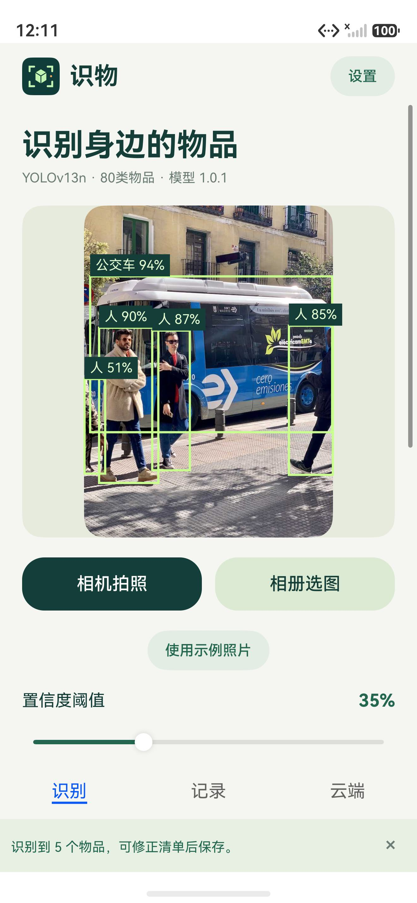
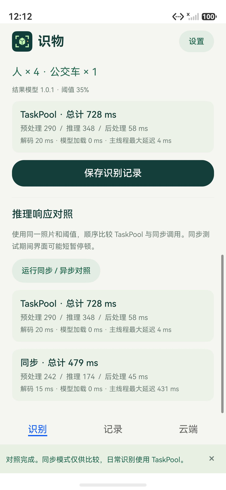
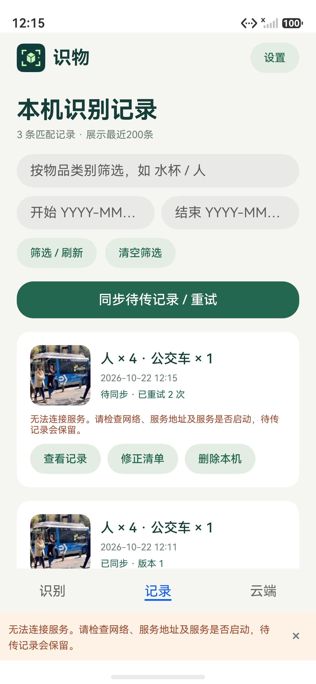
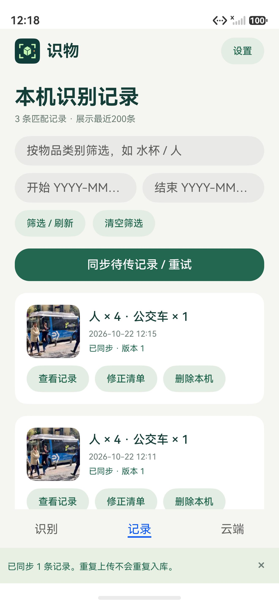
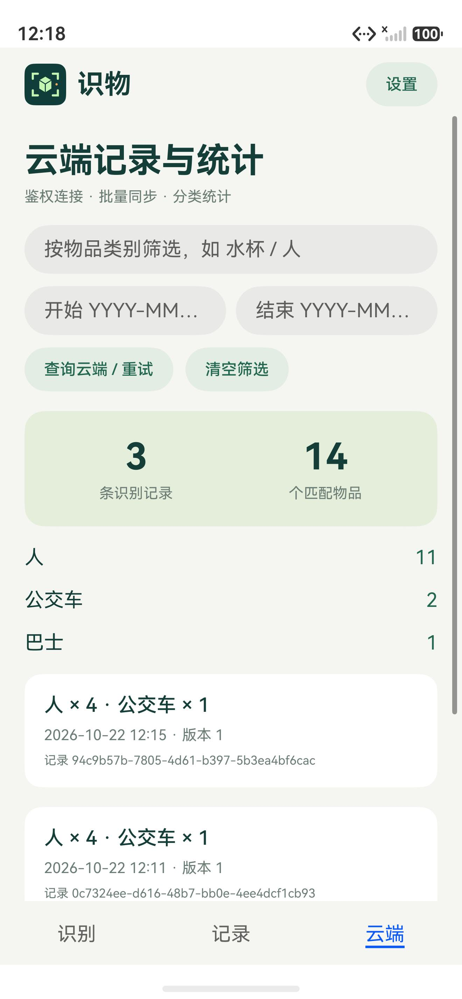
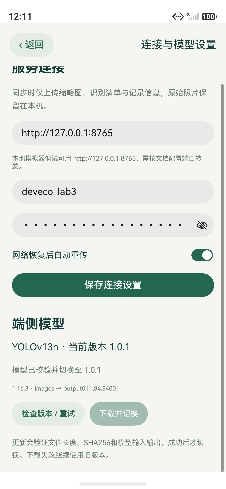

# 实验三验收记录

日期：2026-10-22。工程：`apps/SmartObjectAssistant`，包名`cn.gdut.smartobjects`。验证使用本机 DevEco Studio 6.1.1、HarmonyOS API24、Pura 90 x86_64手机模拟器；后端是本机FastAPI，经HDC反向端口转发连接。

## 构建及自动检查

| 检查 | 实际结果 |
| --- | --- |
| `scripts/build.ps1` | Hvigor assembleHap成功；ArkTS、CMake和两种ABI完成，安装并运行未签名HAP |
| `scripts/test-core.cjs` | 执行实际ETS，letterbox/RGB/归一化/NCHW、横竖图、坐标还原、两种输出布局、分类NMS、阈值边界；Node SQLite事务、类别索引、时间筛选、退避持久化及旧确认保护通过 |
| `scripts/test-services.cjs` | 实际ETS服务＋受控HTTP/文件替身：401刷新、鉴权合并、连接释放、配置切换竞态、失败恢复、单上传、修订保护、成功通知、模型摘要/长度/路径/图校验及原子切换通过 |
| `python -m pytest server/tests -q` | **10 passed**；有一条依赖AnyIO的弃用提示。覆盖鉴权、过期/伪造JWT、幂等与修订、设备隔离、筛选分页、批事务回滚、并发重传、模型鉴权下载、请求校验、请求体限制及发布版本不可变 |
| 官方模型参考推理 | 官方PT实际导出ONNX，Windows ORT执行；独立NumPy张量与实际ETS预处理最大误差≤1e-6；`scripts/verify-reference.cjs`对实际ONNX原始输出解码为4个人和1辆公交车 |

参考校验命令需要自行导出的张量与原始输出文件，具体参数见脚本；普通构建不依赖Python/PyTorch。算法和服务替身测试不替代设备验证，下表另列实际设备结果。

## 模拟器实际交互

| 流程 | 实际观察 |
| --- | --- |
| 初始化及离线检测 | 原生ORT1.16.3实际加载随包ONNX；示例图35%阈值检出人×4、公交车×1，框对齐原图 |
| 置信度 | 35%为5个物品，调至90%只保留1辆公交车；恢复35%再次得到5个 |
| 相机 | 允许权限后前后摄像头均预览，切换后拍照返回，真实拍摄文件完成端侧检测；依据设备公布的格式选择PhotoProfile |
| 相册 | 系统PhotoViewPicker选择实际照片，点击完成返回媒体URI，复制到私有目录后真实推理；记录详情可经系统确认导出JPEG到相册 |
| 清单 | 将首条记录“公交车”改为“巴士”，删除1个人；最终人×3、巴士×1，修订3。不是修改模型本身 |
| RDB与筛选 | 强制停止后记录和清单恢复；不存在的类别查询显示0条；清空筛选恢复记录 |
| 后端实联 | App使用真实HTTP取得JWT，上传、查询统计；3条记录、14个物品（人11、公交车2、巴士1）与清单相符 |
| 连接中断恢复 | 移除仅本实验的HDC回环端口转发，保存记录并同步失败；待传次数和友好错误保留。恢复同一转发后App自动上传，无手动重试；成功回调刷新列表并清除旧同步错误 |
| 热更新 | 服务端把同一有效ONNX发布为1.0.1，App发现更新、下载10,288,664字节、校验SHA256与原生会话、切换；新结果记录模型1.0.1，重启保留 |

连接中断采用调试转发故障模拟，未宣称实测物理手机Wi-Fi切换。后端认证异常、JWT过期、分页与输入边界由独立API测试覆盖；真实App→后端链路覆盖上述正常鉴权及恢复上传。

## 同图响应对照

相同示例图、阈值35%、缓存会话、顺序执行一次。单位ms。

| 模式 | 总计 | 解码 | 预处理 | Session.Run | 后处理 | 模型加载 | 主线程最大延迟 |
| --- | ---: | ---: | ---: | ---: | ---: | ---: | ---: |
| TaskPool | 728 | 20 | 290 | 348 | 58 | 0 | 4 |
| 同步 | 479 | 15 | 242 | 174 | 45 | 0 | 431 |

总计还包含边界调用及其它少量开销。主线程延迟来自50ms心跳超出预期间隔的最大值，不是FPS；异步并不保证总耗时更小。本次结果说明同步调用会阻塞界面；不外推真机性能，不视为多次统计基准。

## 可复验操作

1. 按README构建并安装运行；选择“使用示例照片”→开始识别→调整阈值后再次识别。
2. 向下查看耗时，运行同步/异步对照；保存清单、修改类别、删除误检；强制停止后重新进入记录。
3. 启动本机后端，完成设备配置与端口转发；同步待传记录并查询云端，填写类别/日期筛选。
4. 发布1.0.1→设置检查版本→下载并切换→新推理；检查结果标注模型版本。
5. `hdc -t <设备> fport rm tcp:8765 tcp:8765`移除本实验转发，保存新结果并重试；`hdc -t <设备> rport tcp:8765 tcp:8765`恢复，保持App可见等待自动检查。

相机、相册需要通过系统权限/选择界面操作；模拟器相机环境与真机不同。本次未验证物理手机功耗、持续帧率、长时间运行，也未部署公共后端。

## 实际截图

公开图片使用上游公开示例，不包含私人相机画面、设备密钥或JWT。
