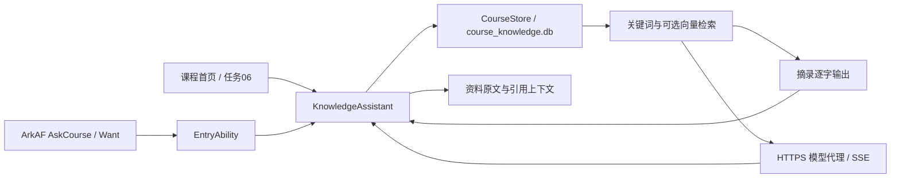
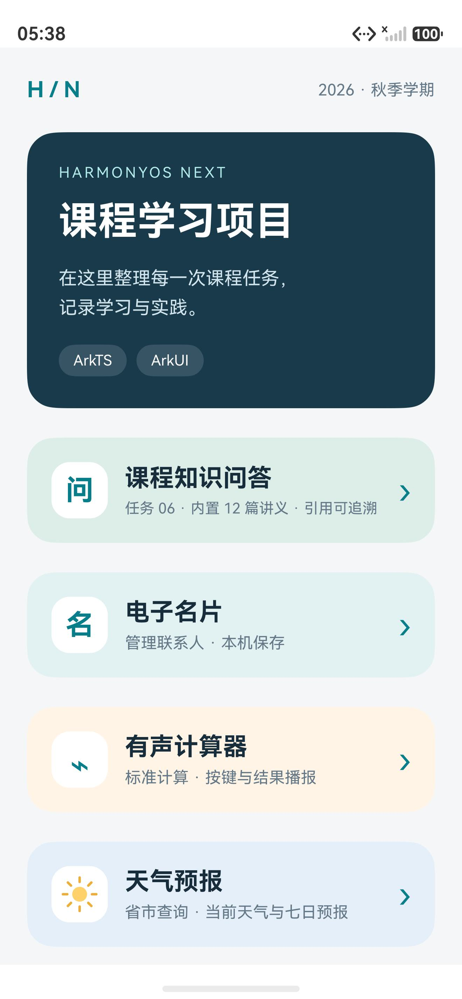
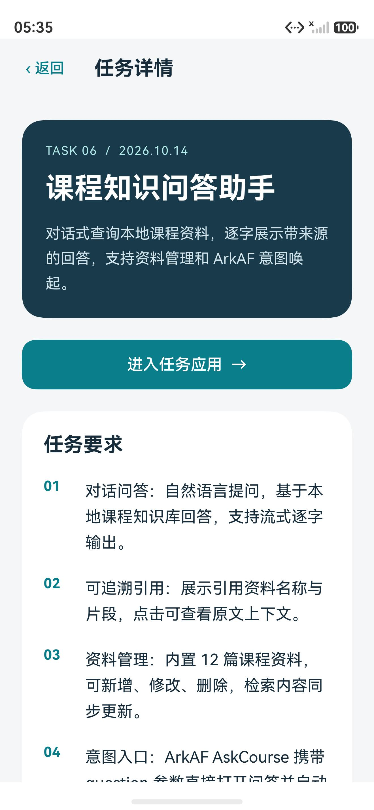
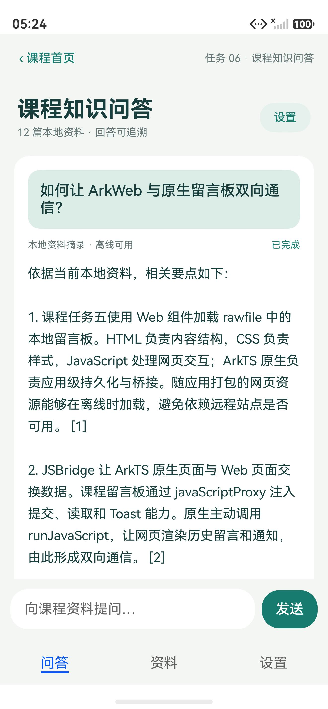
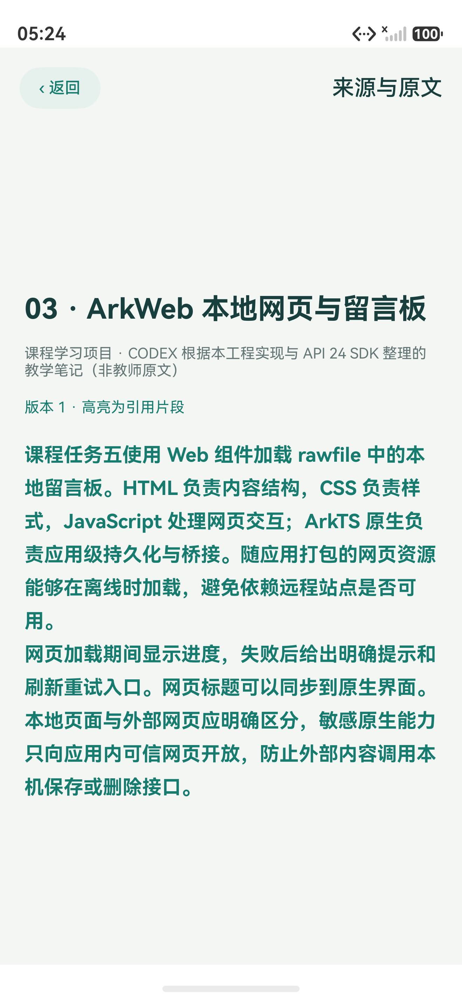
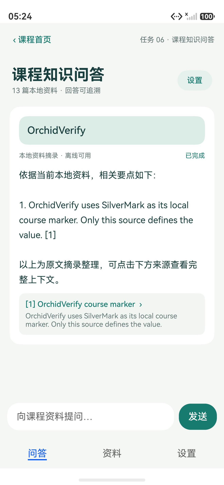
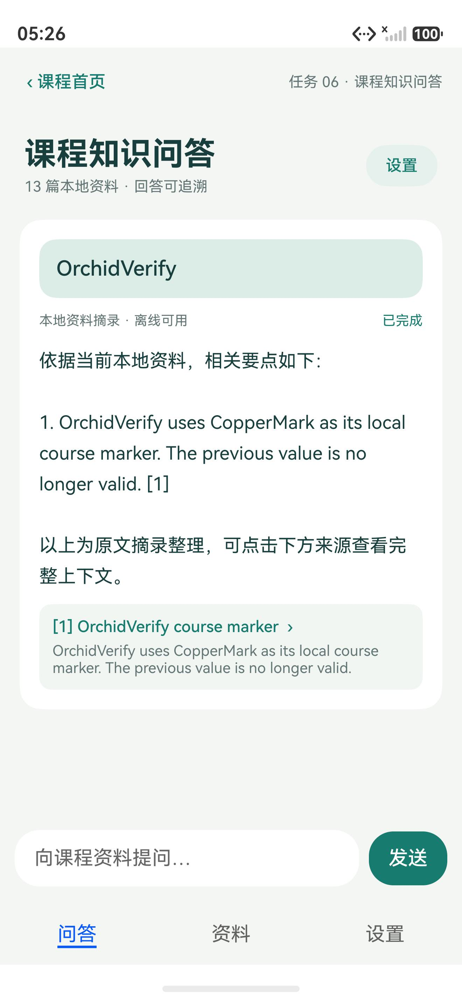
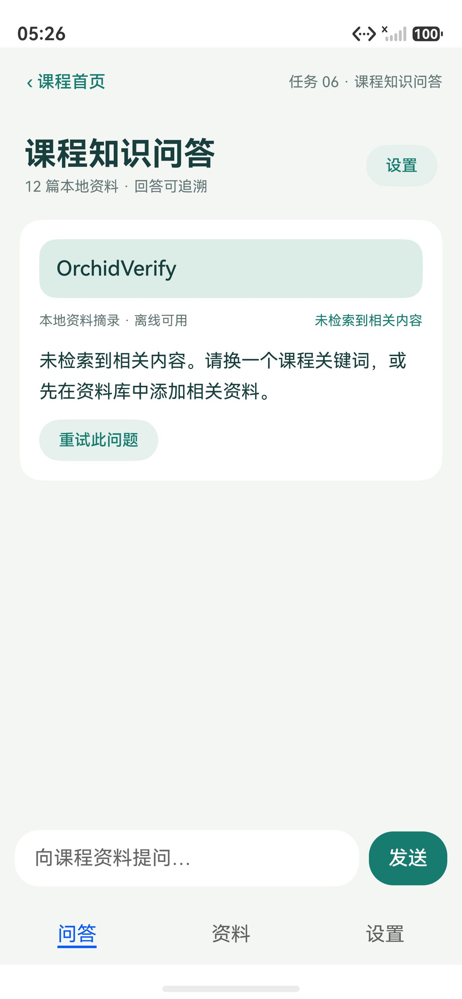

# 课程任务 06 课程知识问答助手

布置日期：2026-10-14。提交截止：2026-10-22（周四）前。

本功能位于**仓库根目录的“课程学习项目”App**，使用校徽图标和原包名 `cn.gdut.iotsoft.cdz3124001415`。实验二 `apps/AnatomyCourse` 只负责人体解剖浏览与学习记录，不包含本任务。

## 使用方式

打开课程 App 首页 → **课程知识问答**；也可从“我的任务 → 任务 06 → 进入任务应用”进入。问答页顶部可返回课程首页，底部切换问答、资料、设置。

1. 输入自然语言问题，如“留言板怎样与原生通信”。回答逐字显示，可停止与重试。
2. 点击回答下方编号来源卡片，查看资料名称、来源、片段、版本以及高亮原文上下文。
3. “资料”内置 12 篇课程讲义，可新增、阅读／编辑、确认删除。输入资料名和不少于 20 字的正文，保存后索引立即同步；旧会话清空，下一次查询使用新内容。
4. “设置”默认使用离线摘录，可配置自己的 HTTPS 模型代理。模式说明明确区分本地摘录和云端生成。
5. “设置 → 通过 Want 唤起问答”可验证携带问题自动提问，命令行及 ArkAF 元数据见 [意图文档](knowledge-intents.md)。

内置讲义由 CODEX 按本课程工程整理，涵盖 Stage、ArkUI、ArkWeb 留言板、双向桥接、RDB、片段引用、混合检索、云代理、流式协议、ArkAF、异常及本地功能，明确标注为项目讲义，不冒充教师教材原文。

## 架构与数据



| 数据表 | 内容 |
| --- | --- |
| documents | 资料 ID、标题、来源、正文、版本、修改时间 |
| segments | 片段文本、资料 ID、精确正文偏移、版本、向量及模型标识 |
| meta | 首次导入标记、模式及服务地址 |

资料和片段在同一事务中新增、替换或删除，失败回滚。首次导入只执行一次，用户删除的资料不会在重启后重新出现。每次修改递增版本，迟到的向量结果只能写入仍存在且版本匹配的片段。

切分窗口约 440 个 UTF-16 单位、重叠约 60 单位，优先句末并保护代理对。关键词检索包含中文双字词、英文术语和课程同义词，标题加权。启用云端后补齐同模型向量缓存，按余弦相似度检索，以 RRF 合并两路排名，最多取 4 段。来源保存片段及原文偏移，打开来源时重新核对版本。

`@Observed ChatMessage` 与 `@ObjectLink ChatCard` 使增量文字更新到界面。离线回答按 Unicode 码点逐字展示；云端使用持续 UTF-8 解码的 SSE。停止、新问题、离开页面会使旧请求失效；资料事务执行时收到的意图先保留，待保存与列表刷新完成后再提问，避免读到旧索引或吞掉新回答。

## 异常与恢复

| 情况 | 提示与操作 |
| --- | --- |
| 初始化 / 加载 | 显示资料库加载状态；初始化失败可重试 |
| 资料处理中 | 显示处理状态并防止重复提交；失败保留表单，可重新保存 |
| 无网络 | 云端模式显示连接网络或切换本地的提示；本地摘录可离线使用 |
| 没有相关内容 | 建议更换关键词或添加资料，保留“重试此问题” |
| 网络 / 模型失败 | 显示失败状态，可重试；不会把截断流标记为完成 |
| 用户停止 | 结束定时器和网络请求，保留已输出文字并支持重试 |

云端不是默认依赖。仓库提供可部署的代理和模型协议测试，但未配置真实公共模型服务；不宣称已完成真实云模型端到端验收。[服务端部署与密钥配置](knowledge-cloud.md)。

## 本地构建与自动检查

DevEco Studio 打开**仓库根目录**，同步 OHPM，使用 HarmonyOS 6.1.1 / API 24 SDK。根工程无需实验二 Web 依赖或模型构建。

```powershell
.\scripts\build.ps1 -DevEcoHome 'D:\HUAWEI\DevEco Studio'
```

使用 Node.js 24（SQLite 测试使用内置 `node:sqlite`）：

```powershell
node scripts/test-knowledge-core.cjs --deveco-home 'D:\HUAWEI\DevEco Studio'
node scripts/test-knowledge-client.cjs --deveco-home 'D:\HUAWEI\DevEco Studio'
node scripts/test-knowledge-intents.cjs --deveco-home 'D:\HUAWEI\DevEco Studio'
node scripts/test-knowledge-async.cjs --deveco-home 'D:\HUAWEI\DevEco Studio'
node --test cloud/server.test.mjs
```

测试从 DevEco 查找 TypeScript，也可传 `--typescript <typescript.js>`；不依赖 `apps/AnatomyCourse/web/node_modules`。

## 验证记录

2026-10-19：根工程 API 24 构建通过；模型测试覆盖 12 篇种子、初始化失败重试、切分与 Unicode、检索融合、实际 SQLite CRUD、回滚、并发串行化及过期向量拒绝。客户端测试覆盖 SSE 字节边界、CRLF、截断、错误状态、HTTPS 约束及释放；云代理 6 项测试通过。

直接执行实际 EntryAbility 的路由测试覆盖冷启动、任意页面热启动、并发 Want 导航去重、最新问题保留和启动页交接。页面异步测试覆盖取消期间不继续发请求、资料事务完成后消费意图、保存失败后保留输入、模拟无网络和服务失败后的重试恢复。原有留言板 29 项和计算器引擎 26 项回归检查通过。

HarmonyOS 模拟器 `127.0.0.1:5557` 实际操作记录：

| 验证项 | 操作与结果 |
| --- | --- |
| 课程首页入口 | 保留课程首页和旧任务；首页按钮及任务列表中的任务 06 均能进入知识问答，显示 12 篇资料 |
| 逐字回答和来源 | 对课程留言板提问，观察两次采样间答案继续增长；点击引用打开资料名、出处、版本和高亮原文 |
| 新增后立即生效 | 新增 `OrchidVerify course marker`，资料数变为 13，提问得到 `SilverMark` |
| 修改后立即生效 | 把测试资料中的标记改为 `CopperMark`，重新提问只返回新值，不再返回旧值 |
| 删除与重试 | 删除测试资料后恢复 12 篇，查询该标记显示无相关内容；点击重试仍无结果，不使用已删除片段 |
| 冷启动 Want | 停止应用后携带“留言板怎样与原生通信”启动，自动打开问答并回答 |
| 热启动 Want | 在问答页再次携带问题启动，以及从电子名片页携带问题启动，均自动提问并给出来源 |
| URI 参数 | 使用 `courselearning://ask?question=ArkAF` 启动，解析问题并自动回答 |
| 新回答可见 | 同页再次唤起时无需手动滚动即可看到新问题；完成后显示最新内容与引用 |

以上是实际模拟器操作；无网络与模型请求失败后的恢复由可控 mock 测试验证，未把它们写作已进行真实云模型或断网端到端测试。实验二的模型与收藏截图在其独立文档目录。

## 模拟器截图

| 课程首页入口 | 任务 06 详情 |
| --- | --- |
|  |  |

| 对话回答 | 引用原文 |
| --- | --- |
|  |  |

| 新增资料后的答案 | 修改资料后的答案 | 删除资料后的提示 |
| --- | --- | --- |
|  |  |  |
