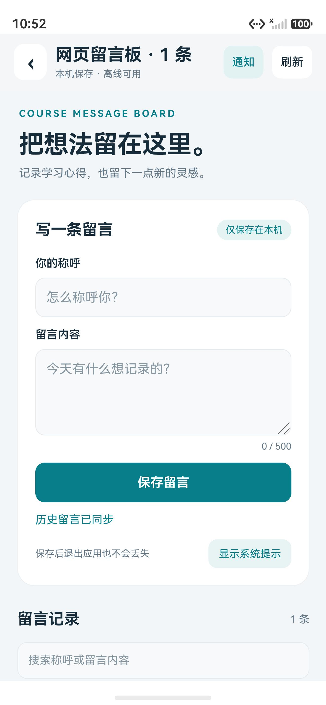
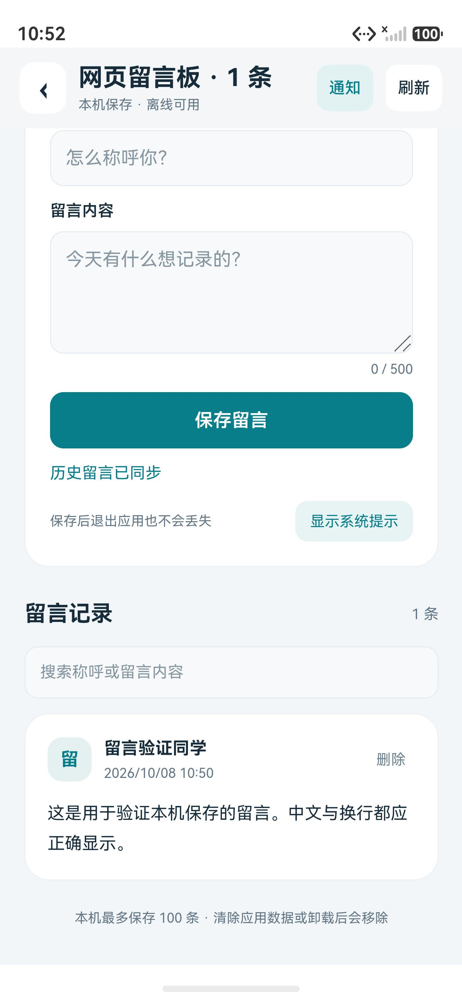
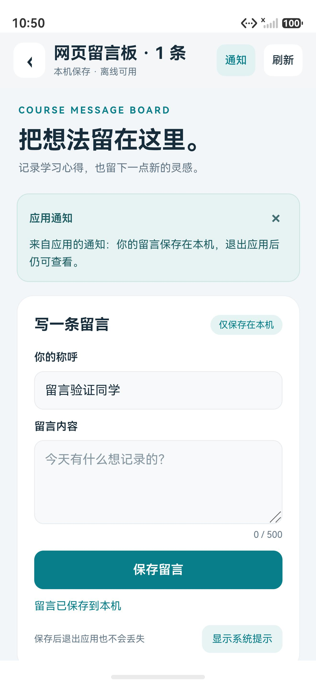

# 网页留言板 · 2026-09-27 课程任务

本功能实现课程要求的本地网页留言板：Web 组件加载 `rawfile` 中的 HTML，通过 `javaScriptProxy` 注入原生能力，由原生保存留言，再使用 `runJavaScript` 将历史记录、操作结果和通知主动推回网页。

原任务要求 10 月 7 日前提交；本次实际实现与验证日期为 **2026 年 10 月 8 日**。

## 操作

1. 首页点击“网页留言板”，或任务列表 → 任务 05 → 进入任务应用。
2. 填写称呼和留言，点击“保存留言”。只有原生写入磁盘成功，网页才会显示成功并清空留言内容。
3. 向下滚动查看记录；可按称呼 / 内容搜索，删除单条留言前需要确认。
4. 网页中的“显示系统提示”调用原生 Toast；顶部原生栏中的“通知”主动向网页推送一条通知。
5. 原生标题自动同步网页标题和留言数量。“刷新”会重新创建 Web 组件并读取历史；刷新前提醒未提交的草稿会清空。

完全离线可用。称呼最多 24、内容最多 500 个 UTF-16 单元（与 HTML `maxlength` 一致；多数常用汉字占一个单元，部分 emoji 占两个），本机最多保存 100 条。容量满后提示用户先删除，不自动丢弃历史。退出应用不会清空已保存留言；卸载或清除应用数据会移除。数据不会上传到 GitHub / Gitee。

## 结构

| 文件 | 职责 |
| --- | --- |
| `entry/src/main/resources/rawfile/message-board.html` | 全部网页结构、CSS、表单、列表、搜索、删除确认、消息接收和渲染 |
| `entry/src/main/ets/pages/MessageBoard.ets` | Web 容器、原生标题栏、进度、加载失败 / 超时重试、生命周期 |
| `entry/src/main/ets/services/MessageBoardBridge.ets` | 代理对象、协议校验、原生向网页发送事件、过期回调隔离 |
| `entry/src/main/ets/model/BoardMessage.ets` | 数据模型、输入边界、存储接口 |
| `entry/src/main/ets/model/MessageStore.ets` | 原生 Preferences 存储、串行操作、失败恢复及重复请求去重 |

页面不直接读写 Preferences；桥接不负责布局；网页不使用 localStorage / IndexedDB 保存留言。Web 表单和消息列表都在 HTML 中实现，并非 ArkUI 模拟的网页表单。

## 双向通信协议

`.javaScriptProxy(...)` 注册 `NativeBoard`，只开放以下四个方法，均立即返回 JSON 字符串 `{ "ok": boolean, "message": string }`。该返回值只表示请求是否接受，保存是否成功以异步事件为准。

| 网页 → 原生 | 参数 | 行为 |
| --- | --- | --- |
| `submitMessage` | JSON 字符串 `{id, author, body}` | 校验后排队保存；成功发送 `saved`，失败发送 `error` |
| `requestHistory` | 无 | 重新读取并发送历史快照 |
| `deleteMessage` | 留言 ID | 删除指定留言后发送剩余列表；重复删除不影响其他记录 |
| `showToast` | 1–80 字提示文本 | 调用系统 Toast，短时间重复调用合并 |

原生 → 网页统一使用：

```javascript
window.MessageBoard.receive({
  kind: 'snapshot', // 或 saved / deleted / notice / error
  requestId: '',
  message: '',
  messages: [],
  sequence: 1
});
```

网页接收函数成功返回 `1`，原生检查结果以确认页面脚本已就绪。打开页面时，`onPageEnd` 主动读取历史并调用此函数，不需要用户先点击网页按钮；通知也由顶部原生按钮独立触发。提交记录的 ID 同时作为请求关联 ID，写入失败时保留草稿。未收到回执重试时沿用同一 ID 和内容，不会重复保存。

同一页面通过递增序号忽略旧事件；刷新或销毁页面会递增原生生命周期标识，旧页面的异步回调不再回写到新页面。离开页面时清理定时器并调用 `deleteJavaScriptRegister` 解除代理。

## 原生存储与失败处理

- 独立 Preferences 文件 `course_message_board_v1`，与个人资料、电子名片、天气数据分离。
- `index` 保存版本和顺序 ID；每条内容保存为 `message_<id>`。单条和最大索引均控制在 Preferences 字符串大小限制内。
- 同一存储的读写按队列执行，多个实例或连续点击不会覆盖彼此的修改。时间戳由原生生成。
- 每次操作等待 `flush()` 完成才返回成功；失败恢复修改前的记录和索引。恢复也失败时移除内存缓存、上报磁盘状态不确定，保留原数据供重读。
- 损坏的索引、缺失记录或无效内容会报错，不会用空列表覆盖坏数据。
- 本地网页加载时有进度条和遮罩；主文档加载失败、Web 进程退出、通信握手失败或 15 秒超时均展示原生错误提示和“重新加载”。存储读取失败在网页内显示重试按钮，保留已有草稿。

## 网页输入与代理边界

只允许内置的 `resource://rawfile/message-board.html`，设置代理来源权限并拦截其他导航。CSP 禁止网络资源、子框架和表单外部提交；网页不依赖 CDN。NativeBoard 仅注册固定方法，不接受来自网页的脚本代码或任意文件路径。

原生向网页发送数据使用 `JSON.stringify` 构造 JSON 字面量，并处理 U+2028 / U+2029；页面使用 `textContent` 创建留言节点，不把用户文字写进 `innerHTML`。`<script>`、引号和换行都作为普通内容保存和显示。

## 实际验证（2026-10-08）

环境：DevEco Studio 6.1、HarmonyOS 6.1.1 / API 24、Pura 90 模拟器；网页补充测试使用独立的无头 Edge 浏览器。

| 检查 | 结果 |
| --- | --- |
| 应用 ArkTS 编译和 HAP 打包 | 通过，安装到模拟器；开发包未签名 |
| ohosTest 测试包 | 构建、安装通过 |
| 本地原生模型 / 存储 / 桥接测试 | **29 / 29** 通过；运行实际 ETS 源码，以平台适配器模拟可控存储失败 |
| 网页浏览器交互测试 | **14 / 14** 通过；使用实际 HTML / CSS / JS，桥接对象为测试适配器 |
| 原生设备存储测试 | **3 / 3** 通过；真实 Preferences 磁盘重读、并发去重、输入校验 |
| 实际 Web 组件与代理 | 中文表单提交 → 原生保存 → 网页收到回执、清空内容 → 原生标题显示 1 条，通过 |
| 实际双向操作 | 网页触发原生 Toast、原生按钮向网页推送通知，通过 |
| 实际应用重启和刷新 | 应用进程重启后读回留言；确认刷新后重新建立 Web / 代理并读回历史，通过 |
| 实际删除 | 取消删除保留记录，确认删除更新列表和标题；本次验证留言已清理 |

29 项本地测试覆盖中文 / emoji / 特殊字符、边界、幂等、并发、磁盘重读、最大容量、保存及恢复失败、损坏数据、通信失败、旧回调、受信 URL 等。14 项浏览器测试覆盖表单、草稿保留、回执、搜索、通知、Toast 调用、删除确认、文本注入防护以及 320 / 377 / 800 像素宽度。

异常存储和握手失败通过可控测试验证；本次未在设备上注入主文档加载失败或强制终止 Web 渲染进程。测试计数不包含未经执行的设备异常路径。

### 复现命令

本地 29 项测试（只需要 DevEco 自带 Node / TypeScript）：

```powershell
& 'D:\HUAWEI\DevEco Studio\tools\node\node.exe' scripts/test-message-board.cjs --deveco-home 'D:\HUAWEI\DevEco Studio'
```

网页测试需要 Node 20 及以上和 Playwright；安装浏览器后运行：

```powershell
node scripts/test-message-board-web.cjs
# Windows 使用已安装的 Edge：
node scripts/test-message-board-web.cjs --edge
```

设备存储测试使用独立测试文件名，结束时清理测试数据，不改动真实留言：

```powershell
.\scripts\build.ps1 -DevEcoHome 'D:\HUAWEI\DevEco Studio'
.\scripts\build.ps1 -DevEcoHome 'D:\HUAWEI\DevEco Studio' -Target ohosTest
$taskHdc = 'D:\HUAWEI\DevEco Studio\sdk\default\openharmony\toolchains\hdc.exe'
& $taskHdc -t 127.0.0.1:5555 install entry/build/default/outputs/default/entry-default-unsigned.hap
& $taskHdc -t 127.0.0.1:5555 install entry/build/default/outputs/ohosTest/entry-ohosTest-unsigned.hap
& $taskHdc -t 127.0.0.1:5555 shell aa test -b cn.gdut.iotsoft.cdz3124001415 -m entry_test -s unittest OpenHarmonyTestRunner -s class MessageBoardStore -s timeout 60000 -w 120
```

## 设备截图

截图只包含专门建立的验证留言。







## 参考

- [华为：前端页面调用应用侧函数](https://developer.huawei.com/consumer/cn/doc/harmonyos-guides/web-in-page-app-function-invoking)：代理、来源权限和解除注册。
- [华为：应用侧调用前端页面函数](https://developer.huawei.com/consumer/en/doc/harmonyos-guides-V14/web-in-app-frontend-page-function-invoking-V14)：`runJavaScript` 调用网页函数。
- [华为：Web 页面加载](https://developer.huawei.com/consumer/cn/doc/harmonyos-guides/web-page-loading)：本地页面加载及加载事件。
- 实际编译契约以本机 API 24 SDK 的 `ets/component/web.d.ts`、`@ohos.web.webview.d.ts` 和 Preferences 声明为准。
